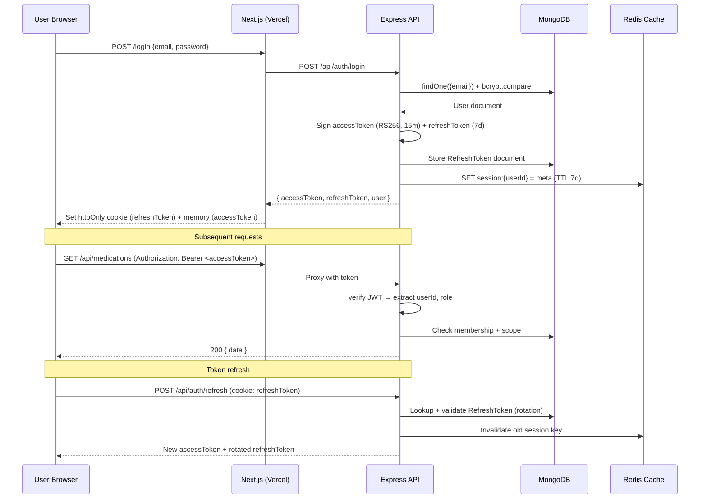
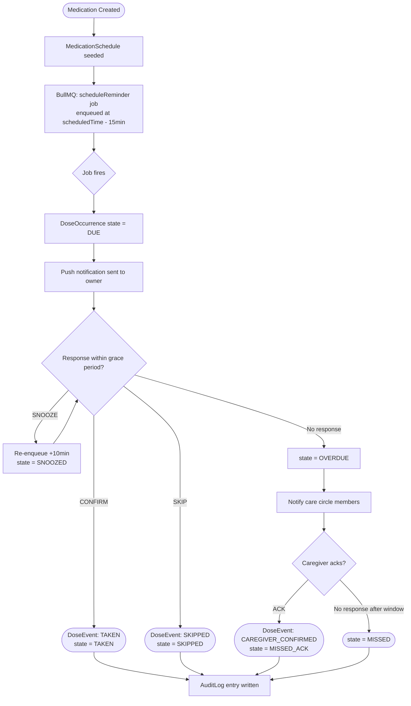
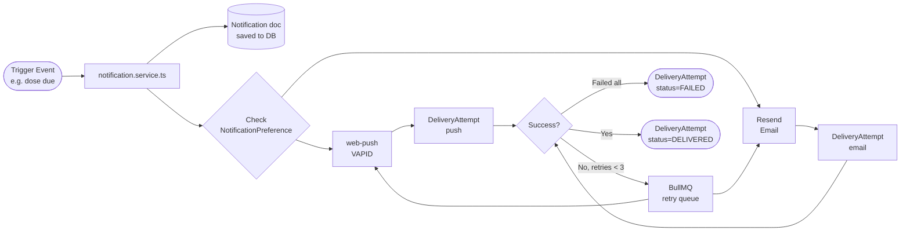

# SaathiCare — System Architecture

> **Brand Palette**: Deep Navy `#193C47` · Care Teal `#147D75` · Soft Mint `#E6F5EF` · Warm Canvas `#F9F7F1` · Warm Accent `#D56A39`

---

## 1. Monorepo Structure

```
saathicare/                              ← Git root
├── apps/
│   ├── web/                             ← Next.js 14 (App Router) frontend
│   │   ├── app/
│   │   │   ├── (auth)/
│   │   │   │   ├── login/page.tsx
│   │   │   │   ├── register/page.tsx
│   │   │   │   └── forgot-password/page.tsx
│   │   │   ├── (dashboard)/
│   │   │   │   ├── layout.tsx
│   │   │   │   ├── dashboard/page.tsx
│   │   │   │   ├── medications/
│   │   │   │   │   ├── page.tsx
│   │   │   │   │   ├── [id]/page.tsx
│   │   │   │   │   └── new/page.tsx
│   │   │   │   ├── appointments/
│   │   │   │   │   ├── page.tsx
│   │   │   │   │   └── [id]/page.tsx
│   │   │   │   ├── health/page.tsx
│   │   │   │   ├── care-circle/page.tsx
│   │   │   │   ├── documents/page.tsx
│   │   │   │   └── settings/page.tsx
│   │   │   ├── accept-invite/[token]/page.tsx
│   │   │   ├── sw.ts                    ← Service Worker (push notifications)
│   │   │   ├── layout.tsx
│   │   │   └── globals.css
│   │   ├── components/
│   │   │   ├── ui/                      ← shadcn/ui primitives
│   │   │   ├── dose/
│   │   │   │   ├── DoseCard.tsx
│   │   │   │   ├── DoseConfirmModal.tsx
│   │   │   │   └── DoseTimeline.tsx
│   │   │   ├── medication/
│   │   │   ├── care-circle/
│   │   │   ├── notifications/
│   │   │   └── layout/
│   │   ├── hooks/
│   │   │   ├── useDoses.ts
│   │   │   ├── usePushSubscription.ts
│   │   │   └── useCareCircle.ts
│   │   ├── lib/
│   │   │   ├── api-client.ts
│   │   │   └── push.ts
│   │   ├── public/
│   │   │   ├── manifest.json            ← PWA manifest
│   │   │   └── icons/
│   │   ├── next.config.ts
│   │   ├── tailwind.config.ts
│   │   └── package.json
│   │
│   └── api/                             ← Express 5 / Node 20 backend
│       ├── src/
│       │   ├── config/
│       │   │   ├── db.ts                ← MongoDB connection
│       │   │   ├── redis.ts             ← Upstash Redis (ioredis)
│       │   │   └── env.ts               ← zod-validated environment
│       │   ├── models/
│       │   │   ├── User.ts
│       │   │   ├── CareProfile.ts
│       │   │   ├── CareCircleMembership.ts
│       │   │   ├── Invitation.ts
│       │   │   ├── ConsentRecord.ts
│       │   │   ├── Medication.ts
│       │   │   ├── MedicationSchedule.ts
│       │   │   ├── DoseOccurrence.ts
│       │   │   ├── DoseEvent.ts
│       │   │   ├── Appointment.ts
│       │   │   ├── Routine.ts
│       │   │   ├── RoutineCompletion.ts
│       │   │   ├── HealthObservation.ts
│       │   │   ├── EmergencyContact.ts
│       │   │   ├── MedicalDocument.ts
│       │   │   ├── NotificationPreference.ts
│       │   │   ├── Notification.ts
│       │   │   ├── DeliveryAttempt.ts
│       │   │   ├── AuditLog.ts
│       │   │   ├── RefreshToken.ts
│       │   │   ├── PushSubscription.ts
│       │   │   └── WeeklyDigest.ts
│       │   ├── routes/
│       │   │   ├── auth.routes.ts
│       │   │   ├── users.routes.ts
│       │   │   ├── careprofile.routes.ts
│       │   │   ├── carecircle.routes.ts
│       │   │   ├── medications.routes.ts
│       │   │   ├── doses.routes.ts
│       │   │   ├── appointments.routes.ts
│       │   │   ├── routines.routes.ts
│       │   │   ├── health.routes.ts
│       │   │   ├── documents.routes.ts
│       │   │   ├── notifications.routes.ts
│       │   │   └── audit.routes.ts
│       │   ├── middleware/
│       │   │   ├── authenticate.ts      ← JWT verification
│       │   │   ├── authorize.ts         ← RBAC + membership check
│       │   │   ├── rateLimiter.ts       ← Upstash rate limiting
│       │   │   ├── uploadHandler.ts     ← multer + S3 presign
│       │   │   └── errorHandler.ts
│       │   ├── services/
│       │   │   ├── auth.service.ts
│       │   │   ├── dose.service.ts
│       │   │   ├── notification.service.ts
│       │   │   ├── scheduler.service.ts ← BullMQ job definitions
│       │   │   ├── push.service.ts      ← web-push
│       │   │   ├── email.service.ts     ← Resend
│       │   │   └── audit.service.ts
│       │   ├── jobs/
│       │   │   ├── doseReminder.job.ts
│       │   │   ├── missedDose.job.ts
│       │   │   ├── appointmentReminder.job.ts
│       │   │   └── weeklyDigest.job.ts
│       │   ├── utils/
│       │   │   ├── timezone.ts          ← luxon helpers
│       │   │   ├── idempotency.ts
│       │   │   └── pagination.ts
│       │   └── app.ts                   ← Express app bootstrap
│       ├── Dockerfile
│       └── package.json
│
├── packages/
│   ├── shared-types/                    ← Zod schemas + TS types (shared)
│   │   ├── src/
│   │   │   ├── auth.ts
│   │   │   ├── medication.ts
│   │   │   ├── dose.ts
│   │   │   └── index.ts
│   │   └── package.json
│   └── ui-tokens/                       ← Design tokens (colors, spacing)
│       ├── src/tokens.ts
│       └── package.json
│
├── .planning/                           ← GSD planning artifacts
├── docs/
│   └── architecture/                    ← ← THIS DIRECTORY
├── turbo.json                           ← Turborepo pipeline
├── pnpm-workspace.yaml
└── package.json
```

---

## 2. Tech Stack

| Layer | Technology | Version | Notes |
|-------|-----------|---------|-------|
| **Frontend Framework** | Next.js (App Router) | 14.x | SSR + React Server Components |
| **UI Components** | shadcn/ui + Radix UI | latest | Accessible primitives |
| **Styling** | Tailwind CSS | 3.x | Custom brand tokens |
| **State Management** | TanStack Query | 5.x | Server state; Zustand for UI state |
| **Forms** | React Hook Form + Zod | 7.x / 3.x | Client-side validation |
| **PWA / Push** | next-pwa + web-push | — | Service worker, VAPID push |
| **Backend Runtime** | Node.js | 20 LTS | — |
| **Backend Framework** | Express | 5.x | — |
| **API Validation** | Zod | 3.x | Shared with frontend |
| **Database** | MongoDB Atlas | 7.x | M0 free tier (hackathon) |
| **ODM** | Mongoose | 8.x | TypeScript-first |
| **Cache / Queue Broker** | Upstash Redis | — | Serverless Redis REST API |
| **Job Queue** | BullMQ | 5.x | Backed by Upstash Redis |
| **Auth** | JWT (access + refresh) | — | RS256, 15 min / 7 day TTL |
| **Email** | Resend | — | React Email templates |
| **File Storage** | AWS S3 / Cloudflare R2 | — | Presigned uploads |
| **Monorepo** | Turborepo + pnpm | 2.x / 9.x | Shared packages |
| **Type-check** | TypeScript | 5.x | strict mode |
| **Testing** | Vitest + Supertest | — | Unit + integration |
| **CI/CD** | GitHub Actions | — | PR checks, deploy on merge |

---

## 3. Deployment Topology

```
┌─────────────────────────────────────────────────────────────────────────┐
│                            Internet / CDN                               │
└──────────────────────────────┬──────────────────────────────────────────┘
                               │ HTTPS
                ┌──────────────▼──────────────┐
                │     Vercel (Edge Network)   │
                │  apps/web  (Next.js 14)     │
                │  - SSR pages               │
                │  - API proxy /api → backend │
                │  - Service Worker (PWA)     │
                └──────────────┬──────────────┘
                               │ REST (HTTPS)
                ┌──────────────▼──────────────┐
                │  Render / Railway           │
                │  apps/api  (Express 5)      │
                │  - REST API :3001           │
                │  - BullMQ workers           │
                │  - web-push dispatcher      │
                └───┬───────────────┬─────────┘
                    │               │
         ┌──────────▼──┐    ┌───────▼──────────┐
         │ MongoDB      │    │ Upstash Redis     │
         │ Atlas        │    │ (Serverless)      │
         │ (M0 cluster) │    │ - Session cache   │
         └──────────────┘    │ - BullMQ queues   │
                             │ - Rate limit ctrs │
                             └───────────────────┘
                    │
         ┌──────────▼──────────┐
         │  AWS S3 / CF R2     │
         │  Medical documents  │
         │  Presigned URLs     │
         └─────────────────────┘
                    │
         ┌──────────▼──────────┐
         │  Resend (Email)     │
         │  VAPID Web-Push     │
         └─────────────────────┘
```

---

## 4. Data Flow Diagrams

### 4.1 Authentication Flow



### 4.2 Medication Dose Lifecycle Flow



### 4.3 Notification Pipeline



---

## 5. Service Boundaries & Communication Patterns

| Boundary | Protocol | Auth | Notes |
|----------|----------|------|-------|
| Browser ↔ Next.js | HTTPS | Cookie (session) | SSR pages, RSC |
| Next.js ↔ Express API | HTTPS REST | JWT Bearer | Vercel rewrites proxy |
| Express ↔ MongoDB | Mongoose driver | Connection string (Atlas) | TLS required |
| Express ↔ Upstash Redis | HTTPS REST (ioredis) | UPSTASH_REDIS_REST_TOKEN | Serverless-safe |
| Express ↔ BullMQ | Redis (via Upstash) | Same token | Job queuing |
| BullMQ Worker ↔ web-push | HTTPS to FCM/APNs | VAPID keys | Push dispatch |
| BullMQ Worker ↔ Resend | HTTPS | Resend API key | Email dispatch |
| Express ↔ S3/R2 | HTTPS SDK | IAM / R2 token | Presigned upload URLs |

### Authorization Model (layered)

```
Request
  └── authenticate.ts   (is JWT valid? extract userId)
        └── authorize.ts (is user a member of this care profile? what role?)
              └── Permission check (does role + flags allow this operation?)
                    └── Resource-scoped check (does resource belong to profile?)
                          └── Handler
```

All state-mutating endpoints write an `AuditLog` entry with `actor`, `action`, `resource`, `resourceId`, `before`, `after`, `ip`, `userAgent`.
