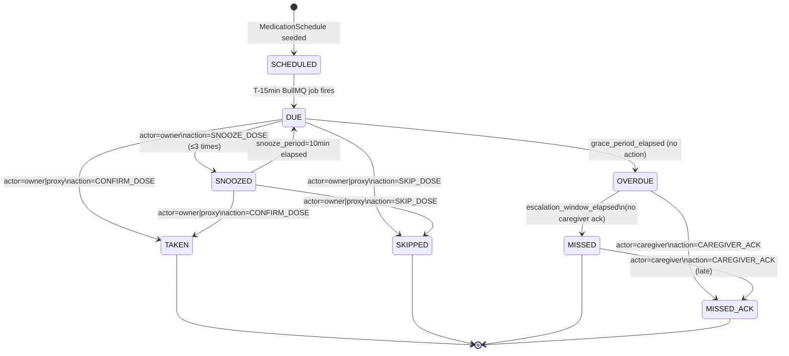

# SaathiCare — Medication Dose Lifecycle

> State machine specification for `DoseOccurrence` and `DoseEvent` documents.

---

## 1. States

| State | Description |
|-------|-------------|
| `SCHEDULED` | Occurrence seeded, reminder not yet due |
| `DUE` | Reminder window opened (≤15 min before scheduled time) |
| `SNOOZED` | Owner requested 10-min delay; still in grace window |
| `TAKEN` | Owner (or authorized proxy) confirmed dose consumed |
| `SKIPPED` | Owner intentionally skipped this dose |
| `OVERDUE` | Grace period elapsed without confirmation or skip |
| `MISSED` | Overdue + escalation window closed; no caregiver ack |
| `MISSED_ACK` | Caregiver acknowledged the miss after the fact |
| `UNCONFIRMED` | Legacy / edge case — created event with no resolution |

---

## 2. State Machine



---

## 3. Transitions Detail

| From | To | Actor | Trigger | Conditions | Side-effects |
|------|----|-------|---------|------------|--------------|
| `SCHEDULED` | `DUE` | System | BullMQ `doseReminder.job` fires at `scheduledTime - 15min` | Job not already processed (idempotency key) | Push/email to owner; DoseOccurrence updated |
| `DUE` | `TAKEN` | `profile_owner` / authorized proxy | `POST /doses/:occurrenceId/confirm` | Grace window open; role=owner or caregiver with `canConfirmDose` | DoseEvent created; AuditLog written; streak updated |
| `DUE` | `SKIPPED` | `profile_owner` / authorized proxy | `POST /doses/:occurrenceId/skip` | Grace window open | DoseEvent created with `reason`; AuditLog written |
| `DUE` | `SNOOZED` | `profile_owner` | `POST /doses/:occurrenceId/snooze` | `snoozeCount < 3`; grace window open | `snoozeCount++`; new BullMQ job `+10min` |
| `SNOOZED` | `DUE` | System | Snooze timer elapses | — | Re-opens confirmation window |
| `DUE` / `SNOOZED` | `OVERDUE` | System | `missedDose.job` fires at `scheduledTime + graceMinutes` | No terminal event exists yet | Push/email to care circle members |
| `OVERDUE` | `MISSED` | System | `escalationClose.job` fires at `scheduledTime + escalationWindowMinutes` | No caregiver ack | DoseEvent(MISSED) created; weekly digest flag set |
| `OVERDUE` | `MISSED_ACK` | `caregiver` | `POST /doses/:occurrenceId/caregiver-ack` | Role=caregiver in care circle | DoseEvent(MISSED_ACK) created; AuditLog written |
| `MISSED` | `MISSED_ACK` | `caregiver` | Same endpoint (late ack) | — | DoseEvent updated |

---

## 4. Escalation Policy

```
T - 15 min  ─── [SCHEDULED → DUE] ──► Push notification to owner
                                       Email notification (if pref enabled)
T + 0 min   ─── Scheduled time passes
T + graceMinutes (default 30 min)
            ─── [DUE → OVERDUE] ──────► Push/email to ALL care circle members
                                        (family_member + caregiver)
                                        Message: "Dose overdue for <name>"

T + escalationWindow (default 90 min)
            ─── [OVERDUE → MISSED] ───► Notification to owner + care circle
                                        DoseEvent(type=MISSED) persisted
                                        Weekly digest missed-dose counter++
```

### Escalation Configuration (per `NotificationPreference`)

```typescript
interface EscalationPolicy {
  graceMinutes: number;          // default: 30
  escalationWindowMinutes: number; // default: 90
  maxSnoozeCount: number;        // default: 3
  snoozeDurationMinutes: number; // default: 10
  notifyCareCircleOnOverdue: boolean; // default: true
  notifyOwnerOnMissed: boolean;  // default: true
}
```

---

## 5. Policy Rules for "Missed" Classification

> **KEY PRINCIPLE**: Missed classification is **time-based**, not delivery-based.
> A dose is MISSED if the escalation window elapses without a terminal event —
> regardless of whether the notification was delivered.

1. **Delivery failure does NOT prevent MISSED**: If push/email fails, the dose
   still transitions to `MISSED` when the escalation window closes.
2. **Snooze does NOT reset the grace clock**: Snooze delays the reminder only;
   `scheduledTime + graceMinutes` is computed from the **original** scheduled time.
3. **Back-dating is prohibited**: A CONFIRM or SKIP event cannot be recorded after
   the dose has entered `MISSED` state (unless role=caregiver using `caregiver-ack`).
4. **Idempotency**: All BullMQ jobs carry an idempotency key `dose:{occurrenceId}:{jobType}`.
   Duplicate job processing is a no-op (returns 200 without mutation).
5. **Timezone correctness**: All scheduled times are stored as UTC instants.
   The displayed time in notifications uses the care profile's `timezone` field
   (IANA tz string). DST transitions are handled by `luxon`.

---

## 6. DoseOccurrence ↔ DoseEvent Relationship

```
DoseOccurrence (1)
  ├── id
  ├── medicationId
  ├── scheduledTime (UTC)
  ├── state: DoseState        ← updated by transitions
  ├── snoozeCount: number
  └── ...

DoseEvent (0..N per occurrence)
  ├── occurrenceId            ← FK to DoseOccurrence
  ├── type: TAKEN | SKIPPED | MISSED | MISSED_ACK | CAREGIVER_ACK
  ├── actor: userId
  ├── timestamp
  ├── reason?: string
  └── notes?: string
```

A single `DoseOccurrence` can have at most one **terminal** `DoseEvent`
(TAKEN, SKIPPED, MISSED). `MISSED_ACK` events may be added after `MISSED`.

---

## 7. BullMQ Job Definitions

```typescript
// Enqueued when DoseOccurrence is created (or rescheduled)
interface DoseReminderJobData {
  occurrenceId: string;
  profileId: string;
  medicationName: string;
  scheduledTime: string; // ISO UTC
}
// Queue: "dose-reminders"
// delay: scheduledTime - 15min - now

interface MissedDoseJobData {
  occurrenceId: string;
  profileId: string;
  graceMinutes: number;
}
// Queue: "missed-dose"
// delay: scheduledTime + graceMinutes - now

interface EscalationCloseJobData {
  occurrenceId: string;
  profileId: string;
}
// Queue: "escalation-close"
// delay: scheduledTime + escalationWindowMinutes - now
```
